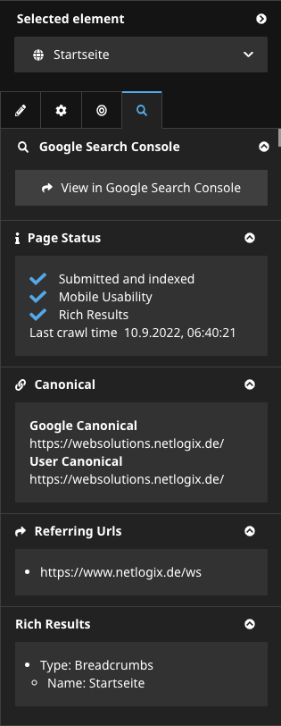

# Netlogix.GoogleSearchConsoleInspector

This package adds an inspector tab for document level nodes, which provides insights into Google Search Console data for the given document, provided by the [Google Search Console URL Inspection API](https://developers.google.com/search/blog/2022/01/url-inspection-api).

### Installation

```shell
composer require netlogix/googlesearchconsoleinspector
```

| Supported Neos Versions |
|-------------------------|
| ^ 8.3                   |
| ~ 9.0.0                 |

### Configuration
A JSON credentials file for a Google service account is required. See [Create a service account](https://developers.google.com/workspace/guides/create-credentials?hl=en#create_a_service_account) for details.
The path to the credentials file should be set in the environment variable `GOOGLE_APPLICATION_CREDENTIALS`.

Alternatively, the path can be set at the configuration path `Netlogix.GoogleSearchConsoleInspector.api.clientConfig.credentials`.

At `Netlogix.GoogleSearchConsoleInspector.siteUrlMapping` add the mapping of Google Search Console Properties to URL prefixes for your site.
Please refer to [Google's documentation](https://developers.google.com/webmaster-tools/v1/urlInspection.index/inspect) for details.

```yaml
Netlogix:
  GoogleSearchConsoleInspector:
    api:
      # See https://github.com/googleapis/google-api-php-client/blob/main/src/Client.php#L112
      clientConfig:
        'application_name': 'Neos Search Console Inspector'

        # See https://developers.google.com/workspace/guides/create-credentials?hl=en#create_a_service_account
        'credentials': '%env:GOOGLE_APPLICATION_CREDENTIALS%'

    siteUrlMapping:
      'sc-domain:example.org':
        - 'https://www.example.org'
        - 'https://example.org'

      'https://www.example.com':
        - 'https://www.example.com'
```

For document nodetypes you want to inspect, add the `Netlogix.GoogleSearchConsoleInspector:Inspectable` to the supertypes. This will add the inspector tab to the document node.

```yaml
'Neos.Demo:Document':
  superTypes:
    'Netlogix.GoogleSearchConsoleInspector:Inspectable': true
```

### Usage

On document level nodes a new tab will be added in the left-hand inspector window. It provides the following functionality:



The first section offers a button leading directly to Googles own [URL Inspection Tool](https://support.google.com/webmasters/answer/9012289), preconfigured with the current page data.

The "Refresh" button fetches current data from Google, bypassing the response cache (24 hours by default).

"Search Performance" shows clicks, impressions, CTR and position of the page for the last 28 days compared to the 28 days before, plus its top queries, provided by the [Search Analytics API](https://developers.google.com/webmaster-tools/v1/searchanalytics/query).

"Content Hints" lists queries with at least 10 impressions that rank on position 8 to 20, and queries whose words are missing from the `title`, `titleOverride` and `metaDescription` properties of the document.

The second sections provides data about Google's [indexing status](https://support.google.com/webmasters/answer/9012289?hl=en#using_the_tool), [rich results]((https://developers.google.com/search/docs/appearance/structured-data/intro-structured-data)) availability and the last time the site was crawled.

The third section displays information about the current Google and user [canonicals](https://developers.google.com/search/docs/crawling-indexing/consolidate-duplicate-urls) used. A warning is shown if Google chose a different canonical than the page declares.

The fourth section contains a list of Urls for which Google is aware of the current page is being referenced from.

The last section shows information Google has about the [structured data](https://developers.google.com/search/docs/appearance/structured-data/intro-structured-data) the page contains.

### Backend module

The "Search Console" module in the management section shows top pages, top queries and the sitemap status per configured property, plus the pages that are not indexed. It is granted to `Neos.Neos:Administrator` only, since it shows the data of all properties. Grant the privilege target `Netlogix.GoogleSearchConsoleInspector:Module` to other roles as needed.

The list of pages that are not indexed is built by a command that inspects every URL of the sitemaps submitted in Search Console. Run it as a daily cron job:

```shell
./flow googlesearchconsoleinspector:inspectsitemaps
```

Google allows 2000 inspections per property and day. Use `--limit` (1000 by default) for larger sites. Gzipped sitemaps are not supported yet.

### Checking the setup

```shell
./flow googlesearchconsoleinspector:checksetup
```

lists the permission level of the service account for every property in `siteUrlMapping` and fails if one of them is not accessible.
